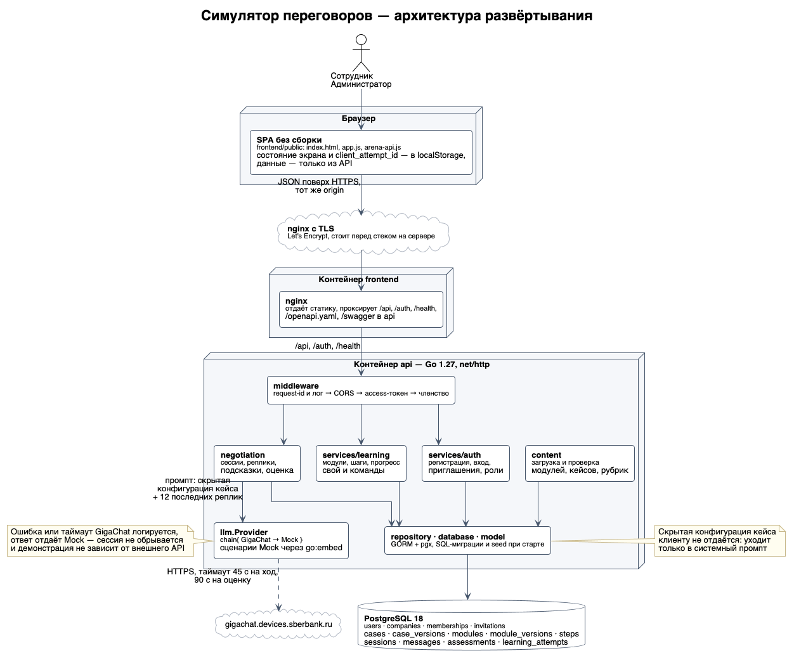

# Арена переговоров

Тренажёр деловых переговоров для кейса № 19 хакатона «Лидеры цифровой трансформации — 2026» (заказчик — ОЭЗ «Алабуга»). Сотрудник изучает приёмы переговоров, отрабатывает их в диалоге с ИИ-оппонентом и получает разбор по критериям. Администратор компании приглашает участников и видит их прогресс.

**Стенд:** [vozduhanchiki.ru](https://vozduhanchiki.ru)

**Демо-доступ:** компания `Demo`, администратор `demo@mail.com` / `demo-password-sdf423n523`. Новых участников добавляют через приглашения в разделе «Сотрудники»; обычная регистрация не даёт членства в компании.

## Возможности

- **Обучение** — четыре модуля по шесть шагов (теория и вопросы), после каждого — проверочный переговорный кейс, который открывает следующий модуль.
- **Практика** — четыре тренировочных кейса, диалог с оппонентом, до трёх подсказок, повторные попытки.
- **Обратная связь** — три критерия рубрики, каждый подтверждается цитатой из реплик участника; итог и рекомендация.
- **Прогресс и команда** — история сессий и статусы модулей; администратор видит прогресс компании.
- **Работа без ключа ИИ** — без GigaChat (или при его сбое) ответы и оценку выдаёт встроенный сценарный Mock.

## Архитектура

Три контейнера: статический фронтенд за nginx, Go-сервис API и PostgreSQL. Единственная внешняя зависимость — GigaChat, и она необязательна.



| Слой | Пакеты | Ответственность |
|---|---|---|
| Транспорт | `internal/transport/http`, `internal/middleware` | Маршруты, CORS, rate limit входа, логирование, Swagger |
| Домен | `internal/negotiation`, `internal/services/learning`, `internal/services/auth` | Сессии и модули, промпты, разбор вердикта, права и токены |
| Данные | `internal/repository`, `internal/database`, `internal/model` | SQL-миграции (применяются при старте), доступ к таблицам |
| Контент | `internal/content` | Загрузка JSON-модулей, кейсов и рубрик, версии в БД |
| ИИ | `internal/llm` | Интерфейс `Provider`, цепочка GigaChat → Mock |

Ключевые решения:

- Скрытая конфигурация кейса (интерес, условия, роль оппонента) уходит только в системный промпт и не отдаётся клиенту.
- Критерий оценки засчитывается, только если модель вернула цитату, реально найденную в репликах участника.
- Кейсы, модули и рубрики — данные в [`backend/api-service/content`](backend/api-service/content/), а не код.
- Изменяющие запросы идемпотентны (`client_attempt_id`, повторный `finish`).

Подробнее: [`api/openapi.yaml`](api/openapi.yaml), [архитектура бэкенда](docs/materials/26_GO_BACKEND_ARCHITECTURE/26_GO_BACKEND_ARCHITECTURE.md), [архитектура ИИ](docs/materials/23_AI_ARCHITECTURE/23_AI_ARCHITECTURE.md).

## Стек

| Слой | Технологии |
|---|---|
| Бэкенд | Go 1.27, `net/http`, `log/slog`, GORM + pgx, `cleanenv` |
| БД | PostgreSQL 18 |
| Аутентификация | JWT HS256 (access) + ротируемый refresh в httpOnly-cookie, PBKDF2-SHA256 |
| ИИ | GigaChat REST API, резерв — сценарный Mock |
| Фронтенд | HTML/CSS/JS без фреймворка и сборки |
| Инфраструктура | Docker Compose, nginx, Certbot, CI/CD в `.sourcecraft/ci.yaml` |
| Качество | `go vet`, `golangci-lint`, `go test -race`, интеграционные тесты на PostgreSQL |

## Быстрый старт

Нужны Docker с Compose v2 и свободные порты `3000`, `8090`, `5432`.

```bash
cp .env.example .env
```

Заполните в `.env` два обязательных поля — `DB_PASSWORD` и `JWT_SECRET` (например, `openssl rand -hex 32`). Остальное подходит для локального запуска как есть; пустые `GIGACHAT_*` включают Mock.

```bash
make up
```

Создайте компанию и администратора:

```bash
docker compose -f compose.dev.yaml exec \
  -e BOOTSTRAP_COMPANY_NAME='Демо-компания' \
  -e BOOTSTRAP_ADMIN_EMAIL='admin@example.test' \
  -e BOOTSTRAP_ADMIN_NAME='Администратор' \
  -e BOOTSTRAP_ADMIN_PASSWORD='change-this-password' \
  api /app/bootstrap
```

| Адрес | Назначение |
|---|---|
| [localhost:3000](http://localhost:3000) | Веб-интерфейс |
| [localhost:8090/swagger](http://localhost:8090/swagger) | Описание API |
| [localhost:8090/health/ready](http://localhost:8090/health/ready) | Готовность API и БД |

### GigaChat (опционально)

Получите ключ в [developers.sber.ru/studio](https://developers.sber.ru/studio) и пропишите в `.env`:

```dotenv
GIGACHAT_AUTH_KEY=<авторизационные данные>
GIGACHAT_SCOPE=GIGACHAT_API_PERS
GIGACHAT_MODEL=GigaChat
```

Затем `docker compose -f compose.dev.yaml up -d --force-recreate api`. В логе должно появиться `GigaChat provider enabled`. Сертификаты НУЦ Минцифры из [`deploy/certs`](deploy/certs/) устанавливаются в образ автоматически.

## Команды

| Команда | Что делает |
|---|---|
| `make up` / `make down` | Запуск и остановка локального стека |
| `make ps` / `make logs` | Состояние и логи контейнеров |
| `make test` | Go-тесты с `-race -cover` |
| `make vet` / `make lint` | Статические проверки |
| `make integration BE3_TEST_DSN='…'` | Интеграционные тесты на одноразовой PostgreSQL |
| `make prod` / `make prod-down` | Серверный стек из `compose.yaml` |
| `make bootstrap COMPANY=… EMAIL=… ADMIN_NAME=… PASSWORD=…` | Компания и администратор в серверном стеке |

## Структура репозитория

```text
api/openapi.yaml                   Контракт REST API
backend/api-service/cmd/           API и команда bootstrap
backend/api-service/internal/      Конфигурация, миграции, сервисы, HTTP, ИИ
backend/api-service/content/       Модули, кейсы и рубрики в JSON
backend/testdata/                  Контрольные диалоги для Mock
frontend/public/                   Веб-интерфейс
deploy/                            nginx, Certbot, сертификаты GigaChat
docs/                              Материалы кейса и архитектура
compose.dev.yaml / compose.yaml    Локальный и серверный стеки
```
